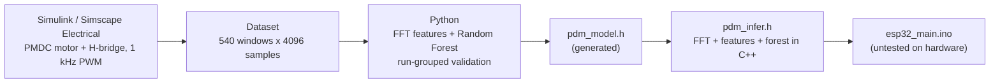
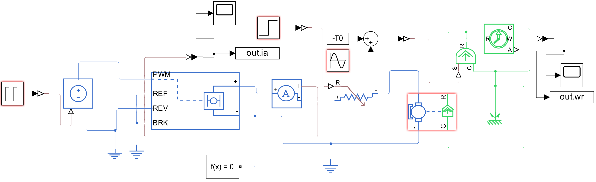

# AI-Driven Predictive Maintenance for PWM DC Motors


-blue)


> **Status:** a complete, simulation-validated pipeline. The C++ inference engine is verified against
> Python on a PC. The ESP32 sketch is a reference implementation that **has not been run on hardware**,
> and all data is synthetic. See [Limitations](#limitations).

## Overview

This project connects power-electronics simulation to embedded Edge AI. It classifies **4096-sample windows
of armature current** (10 kHz, 0.41 s) from a PWM-driven DC motor into three states:

| Class | State | How it is modelled |
|:--|:--|:--|
| 1 | Healthy | Constant load, 1 kHz PWM, duty 80-95 % |
| 2 | Electrical fault | Turn-to-turn armature short: torque constant and series resistance reduced by 10-25 % |
| 3 | Mechanical fault | Rotor-imbalance torque ripple, 0.02-0.06 N·m at 22-27 Hz (about the shaft frequency) |

The whole signal-processing and inference path is **dependency-free C++11** (`float` only, no heap, no STL),
sized for the ESP32's single-precision FPU.



## System architecture

### 1. Data generation (Simulink / Simscape Electrical, R2024b)



A 12 V PMDC motor (armature 1.0 Ω internal + 1.0 Ω external series resistor used to inject the winding
fault, 5 mH, Kt = Ke = 0.055 N·m/A, J = 2e-4 kg·m²) is driven by an H-bridge at 1 kHz PWM.
`generate_dataset.m` runs **90 simulations (30 per class, 4 s each)** with randomised load, duty cycle,
fault severity, and imbalance amplitude/frequency. The first 1.5 s of each run is discarded
(startup transient), and the rest is cut into 6 windows of 4096 samples at 10 kHz, giving
**540 windows** in `pdm_dataset_v2.mat`. Each window keeps its run ID so validation can be split by run.

### 2. Spectral feature extraction

Each window is mean-removed, periodic-Hann windowed, and passed through an in-place radix-2 FFT. The
**11 features** are:

- mean current (A)
- 9 band energies between 2.5 and 200 Hz, with the estimated white-noise floor (45-200 Hz) subtracted and
  clipped at zero, so the features are largely insensitive to broadband sensor noise
- peak amplitude above the noise floor in the 18-32 Hz mechanical-fault search band

### 3. Model selection with sensor-error augmentation

18 of the 90 runs (6 per class, 108 windows) are held out **by run** before any tuning, so windows from
one run never appear in both training and test. Training data is augmented with modelled sensor errors
(12-bit ADC quantisation at 185 mV/A, white noise, gain error, DC offset). Forest size was chosen by
5-fold `GroupKFold` cross-validation on the training runs: the smallest forest within 1 point of the best
accuracy, which is **20 trees, depth 4**.


## Results (held-out test runs)

| Sensor condition | Accuracy | 95 % Wilson CI |
|:--|:--|:--|
| Clean, 12-bit quantised | 108 / 108 (100.0 %) | 96.6 - 100.0 % |
| 50 mA RMS white noise | 108 / 108 (100.0 %) | 96.6 - 100.0 % |
| Moderate: 20 mA noise, ±5 % gain, ±50 mA offset | 104 / 108 (96.3 %) | 90.9 - 98.6 % |
| Harsh: 20 mA noise, ±10 % gain, ±100 mA offset | 102 / 108 (94.4 %) | 88.4 - 97.4 % |


The mechanical fault was never missed. **Every error is healthy vs electrical**, in both directions: a mild
winding short raises the current only slightly, which overlaps with a healthy motor at high load once the
sensor has gain or offset error.

## C++ vs Python parity and resource budget

The exported C++ (`pdm_infer.h` + `pdm_model.h`) was checked against the Python pipeline on a PC
(x86-64, g++) over all 432 test windows (108 windows x 4 sensor conditions):

- **Forest only** (Python features into the C++ forest): 432 / 432 identical predictions
- **Full pipeline** (raw samples into C++ FFT, features and forest): 432 / 432 identical predictions
- Largest feature difference, `float32` vs `float64`: 1.9e-5 of the feature's full scale

| Resource | Chosen model (20 trees, depth 4) |
|:--|:--|
| Model in flash | 5.3 KB (5,260 bytes; 340 nodes, 180 leaves) |
| Static RAM | 48 KB (2 x 16 KB FFT buffers + 16 KB twiddle table) |
| Compute per window | about 0.28 MFLOP (the 4096-point FFT dominates) + at most 80 tree comparisons |
| Time per window on the ESP32 | **not measured** (estimated at a few ms) |
| Window acquisition | 409.6 ms at 10 kHz; acquisition, not compute, sets the decision rate |

## Repository structure

| File | Purpose |
|:--|:--|
| `pmdc_hbridge_motor.slx` | Simulink / Simscape model: PMDC motor, H-bridge, fault injection, current logging |
| `simulink_model.png` | Screenshot of the model |
| `init_params.m` | Default model parameters (T0, Duty, Kt_motor, R_ext, A_imb, f_imb) |
| `generate_dataset.m` | Runs the 90 simulations and writes `pdm_dataset_v2.mat` |
| `pdm_dataset_v2.mat` | Synthetic dataset: `X` (540 x 4096, amps), `y` (class 1-3), `g` (run ID) |
| `train_export.py` | Run-grouped split, augmentation, size sweep, C++ export and parity check |
| `pdm_infer.h` | Firmware code: radix-2 FFT, feature extraction, soft-voting forest |
| `pdm_model.h` | Generated forest as flat `const` arrays (flash) |
| `test_pdm.cpp` | PC test harness used by the parity check (not firmware) |
| `esp32_main.ino` | Reference ESP32 sketch (ADC sampling, zero calibration, serial output); **untested on hardware** |
| `results.json` | Cross-validation, test and parity metrics |
| `fig_*.png` | Figures used in this README |
| `requirements.txt` | Python dependencies |

## Quick start

### 1. Train, export and verify on a PC

```bash
pip install -r requirements.txt
python train_export.py --data pdm_dataset_v2.mat
```

This regenerates `pdm_model.h`, `results.json` and the figures. The C++ parity check needs `g++`
(MSYS2 / MinGW-w64 or WSL on Windows); add `--no-cpp` to skip it.

### 2. Regenerate the dataset (optional)

Requires MATLAB R2024b with Simulink and Simscape Electrical. Open `pmdc_hbridge_motor.slx`, then run
`generate_dataset.m` (`rng(1)` makes the data reproducible). Expect it to take a while: 90 runs of 4 s.

### 3. Build the firmware (untested)

Put `esp32_main.ino`, `pdm_infer.h` and `pdm_model.h` together in a folder named `esp32_main`, open it in the
Arduino IDE, choose **ESP32 Dev Module**, and upload. Read the sensor-wiring note below first.

## Hardware notes (planned, not yet built)

- **Current sensor:** the ACS712-05B is a 5 V part (output 2.5 V at 0 A, 185 mV/A). Its output must be divided
  down for the ESP32 ADC (max about 3.1 V). The sketch assumes a 10 k / 20 k divider; change `DIVIDER_RATIO`
  to match your wiring.
- **Zero offset:** the classifier relies on mean current, and the tests above show accuracy drops with
  offset error, so the sketch measures the zero-current voltage at boot (motor off).
- **Sampling:** the sketch reports `window` time and `overruns` so you can confirm 10 kHz sampling on real
  hardware before trusting any classification.
- The simulation assumed the ADC step of a 185 mV/A sensor across 3.3 V (about 4.4 mA per step). With the
  divider it is about 6.6 mA, so retrain with that value if you build this.

## Limitations

- All data is synthetic, from one idealised motor model; no real motor or sensor was used.
- Only 18 runs are held out, so the confidence intervals are wide.
- A mild winding short (about 10 % severity) is hard to distinguish from a heavier load using current alone.
- Accuracy depends on sensor gain and offset (94.4 % in the harsh case), so calibration matters.
- The white-noise-floor subtraction assumes a flat noise spectrum; mains pickup or motor harmonics in the
  45-200 Hz band would bias it.
- The C++ was verified on x86-64, not compiled for or run on an ESP32, and on-device timing was not measured.

## Roadmap

- [x] Simulink / Simscape motor and fault-injection model
- [x] Synthetic dataset generation and FFT feature extraction
- [x] Random Forest training with run-grouped validation
- [x] Dependency-free C++ inference with PC parity verification
- [ ] Build the sensor front-end and run `esp32_main.ino` on an ESP32
- [ ] Measure on-device inference time and sampling overruns
- [ ] Validate against real motor data and re-train if needed

## Author

Divyansh Singh, Electrical Engineering, NIT Hamirpur

## License

MIT, see [LICENSE](LICENSE).
