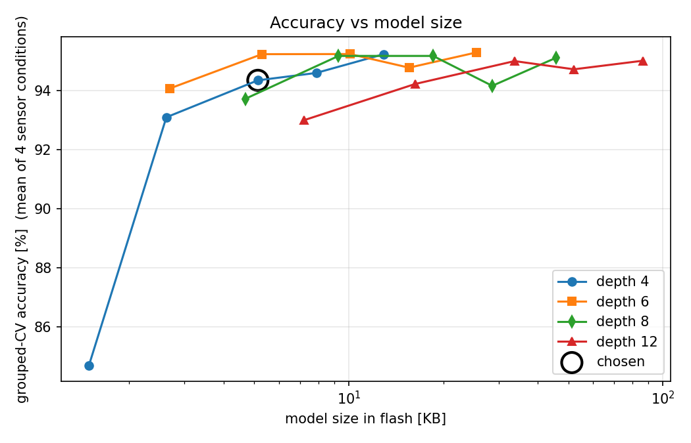
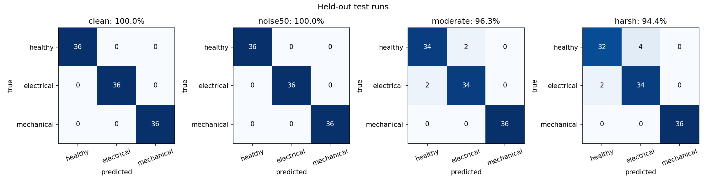

# AI-Driven Predictive Maintenance for PWM DC Motors


-blue)

-success)

## Project Overview
This project bridges the gap between power electronics simulation and embedded Edge AI. It implements a complete Predictive Maintenance (PdM) pipeline that classifies **4096-sample windows of armature current** ($10\text{ kHz}$, $0.41\text{ s}$) from a PWM-driven DC motor into three operating states:
1. **Healthy Operation**
2. **Electrical Fault** (Armature winding short / resistance degradation)
3. **Mechanical Fault** (Rotor imbalance / $18\text{--}32\text{ Hz}$ load torque oscillation)

Instead of relying on cloud telemetry or heavy external runtime libraries, the entire signal-processing and inference pipeline is written in **dependency-free C++11** (`float32` only, zero heap allocation, no STL) tailored for the ESP32's single-precision hardware FPU.

---

## System Architecture

### 1. Simulink / Simscape Electrical Data Generation (`R2024b`)


90 independent simulation runs ($30$ per class) were generated across varying operating conditions and fault severities, exported at $10\text{ kHz}$ into `pdm_dataset_v2.mat` (540 total windows).

### 2. Noise-Immune Spectral Feature Extraction
Rather than feeding raw FFT bins into a classifier, each 4096-sample window is mean-removed, periodic Hann-windowed, and passed through an in-place Radix-2 FFT to extract **11 physical features**:
* **DC Mean Current** ($\text{A}$)
* **9 Spectral Energy Bands** ($2.5\text{--}200\text{ Hz}$) with the estimated white-noise floor ($45\text{--}200\text{ Hz}$) subtracted and clipped at zero, making the features invariant to broadband sensor noise.
* **Peak Amplitude Excess** above the noise floor in the $18\text{--}32\text{ Hz}$ mechanical-fault search band.

### 3. Pareto-Optimal Model Selection & Sensor Fault Augmentation
To prevent time-window data leakage, **18 of the 90 runs** (6 per class, 108 windows) are held out strictly by run ID before any tuning. Training runs are augmented with realistic hardware sensor errors (12-bit ADC quantization at $185\text{ mV/A}$, Gaussian noise, gain error, and DC offset) and evaluated via 5-fold `GroupKFold` cross-validation.



---

## Benchmark Results (Held-Out Test Runs)

Evaluated on 108 unseen windows across four sensor-degradation conditions:

| Sensor Condition | Test Accuracy | 95% Wilson CI |
| :--- | :--- | :--- |
| **Clean** (12-bit ADC quantized) | **108 / 108 (100.0%)** | 96.6% – 100.0% |
| **Noise50** ($50\text{ mA}$ RMS white noise) | **108 / 108 (100.0%)** | 96.6% – 100.0% |
| **Moderate** ($20\text{ mA}$ noise, $\pm 5\%$ gain, $\pm 50\text{ mA}$ offset) | **104 / 108 (96.3%)** | 90.9% – 98.6% |
| **Harsh** ($20\text{ mA}$ noise, $\pm 10\%$ gain, $\pm 100\text{ mA}$ offset) | **102 / 108 (94.4%)** | 88.4% – 97.4% |



---

## C++ vs. Python Bit-Level Parity & Resource Budget

The exported C++ inference engine (`pdm_infer.h` + `pdm_model.h`) is verified against the Python pipeline across all 432 test windows:
* **Model-only parity** (Python features $\rightarrow$ C++ forest): **432 / 432 identical predictions**
* **End-to-end parity** (Raw current samples $\rightarrow$ C++ FFT & features $\rightarrow$ C++ forest): **432 / 432 identical predictions**
* **Max feature deviation** (`float32` vs `float64`): $1.94 \times 10^{-5}$ of full scale

| Resource Metric | Chosen Model (20 Trees, Depth 4) |
| :--- | :--- |
| **Model Flash Footprint** | **5.3 KB** (5,260 bytes; 340 nodes, 180 leaves) |
| **Static RAM** | **48 KB** ($2 \times 16\text{ KB}$ FFT workspace + $16\text{ KB}$ twiddle table) |
| **Compute per Window** | $\sim 0.28\text{ MFLOP}$ (4096-pt FFT) + $\le 80$ tree comparisons |
| **Window Acquisition Time** | $409.6\text{ ms}$ at $10\text{ kHz}$ (acquisition-bound, not compute-bound) |

---

## Repository Structure

| File | Purpose |
| :--- | :--- |
| `Project.slx` | MATLAB R2024b Simulink motor & fault-injection model |
| `pdm_dataset_v2.mat` | Synthetic current dataset (90 runs, 540 windows at $10\text{ kHz}$) |
| `train_export.py` | Run-grouped CV, sensor-noise augmentation, C++ export, and `g++` parity verifier |
| `pdm_infer.h` | Firmware engine: in-place Radix-2 FFT, band-energy extractor, and soft-voting forest |
| `pdm_model.h` | Auto-generated flat `const` tree arrays stored in Flash |
| `esp32_main.ino` | ESP32 hardware ADC sampling and real-time serial telemetry sketch |
| `test_pdm.cpp` | Host PC C++ test harness for end-to-end numerical verification |
| `results.json` | Complete cross-validation, test, and parity metrics |

## Quick Start

### 1. Train, Export & Verify on PC
```bash
pip install numpy scipy scikit-learn matplotlib
python train_export.py --data pdm_dataset_v2.mat
